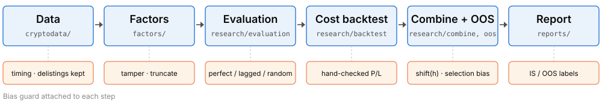
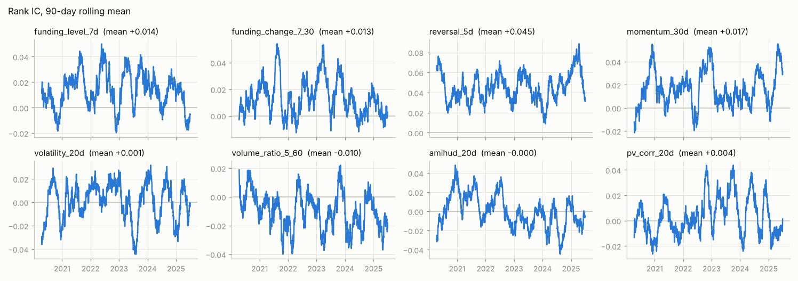
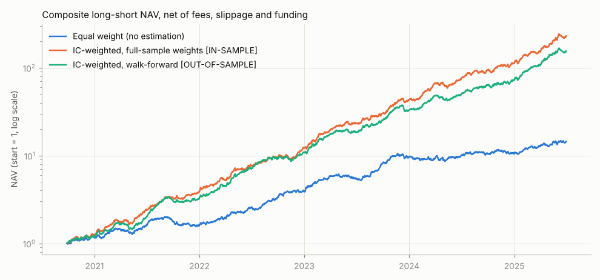
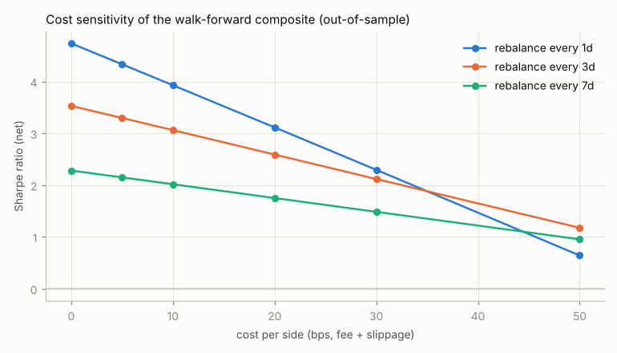

> **[SYNTHETIC DATA WARNING]** Every result in this repository comes from synthetic data generated by `cryptodata/synthetic.py`, and the factor signals were planted by hand. Every IC, return and Sharpe ratio in this handbook shows only whether the pipeline recovers the planted signals. **None of them describe real-market performance.** The real-data downloader (`cryptodata/download.py`) has never been run end to end.
>
> **Source tags**: **[R]** `reports/sample_synthetic/report.md` (sample report committed 2026-10-23); **[P]** `docs/PROGRESS.md`; **[D]** `docs/DECISIONS.md`; **[C]** source constants or tests; **[W]** static counts made in this session with `wc -l` / `grep`. The pipeline was not re-run in this session; see Appendix item 1.

## 1 One-page overview

The question this project can answer: "Given daily bars and funding rates for perpetual futures, can I compute factors, evaluate them, backtest them net of costs, and separate in-sample from out-of-sample honestly, with no look-ahead and no survivorship bias?" It **cannot** yet answer "which factor works in the real market".

| Item | Size | Source |
|-------------|----------------------------------------------------------------------|-----------------|
| Source code | 2,050 lines in 27 `.py` files: `cryptodata` 882, `factors` 158, `research` 579, `reports` 431 | [W] |
| Tests | 595 lines, **67 tests**: data 14, factors 33 (8 factors × 4 kinds + 1), evaluation 8, backtest 6, combination 5, report 1 | [W][P] |
| Look-ahead markers | 14 `# [前视]` (look-ahead) comments in the source, each explaining why only information available at the time is used | [W] |
| Factors | 8 (price 3, volume 2, price-volume 1, funding 2) behind one interface, `f(panel) -> date × symbol` | [C] |
| Sample data | 150 synthetic symbols, 43 delisted within the sample; 2020-01-01 to 2025-06-30; universe = top 50 by liquidity | [R] |
| Dependencies | numpy, pandas, pyarrow, scipy, matplotlib, pytest; the downloader uses only the standard-library `urllib` | [C] |

Three design principles run through the project. (1) **One timing convention everywhere**: factors, universe, labels and backtest align by the same rule. (2) **Every guard has a test that can fail**, not only a comment. (3) **In-sample / out-of-sample labels are generated by code**: each report conclusion carries its label and a test checks it.

## 2 Data layer `cryptodata/`

The data layer does not depend on the factor or research modules and can be imported alone (`from cryptodata import load_panel, liquidity_universe`). The synthetic generator and the downloader emit **the same raw columns**, then share one path: clean → parquet → panel.

| Topic | Convention | Why | Code / tests |
|-----------|---------------------------------|---------------------------|-----------------------------|
| Binance files | `data/futures/um/monthly/klines/<SYM>/1d/<SYM>-1d-<YYYY-MM>.zip`; funding under `.../fundingRate/<SYM>/`; each zip has a sha256 `.CHECKSUM`; 12 kline columns, 3 funding columns | The schema lives in `schema.py`; a new source only has to emit these columns | `download.py`, `schema.py`; `test_synthetic_has_exact_binance_schema` |
| File variants | New files have a header, old ones do not; timestamps in ms or µs (detected by magnitude); old funding files lack the interval column and default to 8h | All of these coexist in the real archive | `download._has_header`, `align.epoch_to_utc`; `test_parse_binance_csv_with_and_without_header`, `test_epoch_units_ms_and_us` |
| Timing convention | A daily bar is keyed by its open date d and covers [d 00:00, d+1 00:00) UTC. **"Information of date d" = what is known at d+1 00:00 UTC (the close of d)** | Factors, universe and rebalancing share one timestamp; any misalignment is look-ahead | `align.py` module docstring |
| Funding attribution | A settlement in **(d 00:00, d+1 00:00]** belongs to bar d; rates are summed per day into `funding` | Open at the start of d and hold to its close: you pay at 08:00, 16:00 and next 00:00. Price return and funding then describe the same holding period and can be added | `align.funding_bar_date` (subtract 1 ms, floor to day); `test_funding_bar_date_rule` |
| Timestamp rounding | Settlement times are rounded to the nearest minute first | Real data has a few ms of jitter (e.g. 00:00:00.004); without rounding, deduplication fails and a settlement lands on the wrong day | `align.round_funding_time` |
| Missing and bad data | The store **never fills** prices; bad bars (non-positive price, inconsistent high/low, negative volume) become NaN but keep their row; the calendar is completed only between first and last day | Forward-filling fabricates zero-volatility, zero-volume days and distorts volatility and volume factors | `clean.py`; `test_missing_day_is_nan_not_filled`, `test_duplicates_and_invalid_rows` |
| Returns across gaps | `r_d = close_d / last valid close − 1`, looking back at most 3 days; the missing day itself is NaN | `pct_change` makes the day after a gap NaN, so the position's P&L silently disappears | `loader.compute_returns`; `test_returns_bridge_missing_day` |
| Liquidity universe | Has a close today, at least 60 valid trading days so far, top N by 30-day average quote volume; uses data up to the close of d only | Slippage in small coins is not achievable; new listings behave oddly and factors need a lookback | `universe.liquidity_universe`; `test_universe_has_no_lookahead` |
| Delisted coins | The symbol list comes from the S3 directory listing (delisted included), not the exchange's "currently trading" endpoint; the panel loads all symbols by default | Studying only survivors overstates returns systematically | `download.list_um_symbols`; `test_delisted_symbols_remain_in_history`, `test_universe_contains_delisted_before_delisting` |
| Delisting flag | `status=DELISTED` when the last bar is more than 3 days before the global end. This table contains future information: **descriptive use only, never for filtering** | Filtering on "eventually delisted" is look-ahead | `store.build_symbol_meta` |
| Memory | One parquet per symbol, float32 columns, filter push-down; a panel estimated above 1 GB raises an error | About 5 GB of RAM locally | `store.py`, `loader._check_memory`; `test_memory_guard` |

Survivorship bias has to be handled in four places at once: **data** (delisted coins stay in history), **universe** (eligible until delisting), **labels** (returns after delisting count as 0, i.e. exit at the last price, so the coin does not vanish from evaluation), and **backtest** (a position with no quote for 3 straight days is force-closed with costs).

## 3 The eight factors `factors/`

Every factor is computed at the close of d from data up to d; values are NaN wherever there is no valid price that day (`base.finalize`). Notation: r = daily simple return, QV = quote volume in USDT, F = daily summed funding rate. "Dir" is a **prior set before looking at data**, from the literature and intuition (+1 means higher value, higher expected return); choosing the sign from sample IC would itself be overfitting.

| Factor | Formula (at d) | Dir | Economic intuition | Planted in synthetic data? |
|-------------------|---------------------------|------|----------------------------|--------------------|
| `reversal_5d` | −Σ ln(1+r), last 5 days | +1 | Short-term overreaction and liquidity shocks revert | Yes, strength 0.025 |
| `momentum_30d` | Σ ln(1+r), d−29 to d−5 (25 days, skipping the last 5) | +1 | Medium-term trend persists; skip recent days to avoid reversal | Yes, strength 0.02 |
| `volatility_20d` | std(r), 20 days | −1 | Low-volatility anomaly | No |
| `volume_ratio_5_60` | ln( mean(QV,5) / mean(QV,60) ) | −1 | Volume spikes signal excess attention, then weakness | No (sign comes out reversed) |
| `amihud_20d` | ln( mean(\|r\|/QV, 20) ) | +1 | Illiquidity earns compensation | No |
| `pv_corr_20d` | corr(r, ln QV), 20 days | −1 | Coins that rise on volume tend to reverse | No |
| `funding_level_7d` | mean(F, 7) | −1 | High funding = crowded longs, who also keep paying | Yes, strength 0.03 |
| `funding_change_7_30` | mean(F,7) − mean(F,30) | −1 | Crowding is building fast | Indirectly (same crowding variable) |

Relative quote volume stands in for turnover because crypto lacks reliable float data [D]. Planted strength is in multiples of idiosyncratic volatility (`SyntheticConfig`) [C].

**A point to raise with an interviewer unprompted**: the generator plants reversal over the past 5 days and momentum over d−30 to d−5, exactly the windows of `reversal_5d` and `momentum_30d`. These factors "work" by construction. That only shows the evaluation chain did not lose or flip the signal.

## 4 Evaluation `research/evaluation.py`

The unit of evaluation is one day's cross-section: compare factor ranks with future-return ranks each day, then average over time, so market-wide moves do not matter. The label is the compounded return from the close of d to the close of d+h (`labels.forward_returns`), **the only function that uses future data on purpose**, and only for evaluation.

| Metric | Definition | Implementation detail and reason | Code |
|----------|----------------------------|------------------------------------|--------------------------|
| IC | Daily cross-sectional Pearson correlation of factor and future return | Vectorised row-wise; checked row by row against scipy (`test_rowwise_corr_matches_scipy`) | `ic_series`, `rowwise_corr` |
| RankIC | Correlation of ranks (Spearman); **the main metric** | Crypto returns are fat-tailed; one outlier can dominate Pearson | `ic_series(method="rank")` |
| ICIR | Mean IC / std of IC | Measures stability; a high mean that flips sign is unreliable | `ic_summary` |
| t-stat | ICIR × √(n/h) | For h>1 adjacent labels overlap and IC is autocorrelated, so effective sample size ≈ n/h; cruder than Newey-West but easy to explain | `ic_summary` |
| IC decay | Mean RankIC at horizons 1, 2, 3, 5, 10, 20 days | Fast decay = short-lived signal = frequent rebalancing = high cost | `ic_decay` |
| Quantile test | Sort the universe into 5 groups daily, equal weight, hold 1 day; LS = group 5 − group 1, no costs | Shows monotonicity; exposes signals that live only in the tails | `quantile_returns` |
| Turnover | Rank autocorrelation (today vs yesterday) and top-group membership turnover | The first measures signal stability, the second maps to traded volume | `rank_autocorr`, `top_group_turnover` |
| Factor correlation | Daily cross-sectional Spearman, averaged over time | Correlated factors double-count information when combined | `factor_corr_matrix` |

Days with fewer than 10 valid names get no IC (`MIN_NAMES`) [C].

## 5 Backtest engine `research/backtest.py`

Daily bookkeeping in notional terms: `NAV` is equity and `q_i` the signed notional in symbol i. Each day t: (1) price P&L `Σ q_i·r_i`; (2) funding `Σ q_i·F_i`, subtracted from NAV, so longs pay when the rate is positive and shorts receive; (3) positions drift, `q_i ← q_i(1+r_i)`; (4) on a rebalance day, trade to `w_i·NAV` and pay costs. `weights.loc[t]` may use only information up to the close of t; fills happen at that close and earn returns from t+1 on.

| Element | Treatment | Default / known approximation |
|------------|----------------------------------------------|------------------------------------------|
| Fee | Traded notional × taker rate | 0.05% (Binance USDT-margined, regular user) [C] |
| Slippage | Traded notional × fixed rate | 0.05%; market impact is **not** modelled against volume [P] |
| Funding | Start-of-day notional × sum of that day's settlement rates | Ignores intraday price moves in the settlement notional (second order) [P] |
| Rebalancing | `rebalance_every`; positions drift on other days | Daily by default; no hidden free rebalancing |
| Execution lag | `execution_lag=L`: day t trades the signal of t−L | Default 0 (fill at the signal day's close), consistent with IC timing |
| Forced close | A held symbol with no price for 3 straight days is closed at its last price, with costs | Uses only the past fact "no quote for 3 days"; never peeks at whether it will delist |
| Portfolio | Long top group, short bottom group, 50% notional each, equal weight | Dollar neutral (`test_long_short_weights_are_dollar_neutral`) |
| Metrics | Annualised on 365 days; Sharpe without a risk-free rate | 24/7 market; no single USDT risk-free rate [D] |

**Hand-checked scenario** (`tests/test_backtest.py::test_hand_calculated_long_short_with_funding`; fee 0.04% + slippage 0.01%, rebalance every 2 days) [C]:

| Day | Event | Arithmetic | NAV |
|------|------------------------------|------------------------------------------------------|----------|
| 0 | Open at close: long A 0.5, short B 0.5 | Traded 1.0; cost 1.0 × 0.05% = 0.0005 | 0.9995 |
| 1 | A +10%, B +5%; funding A +0.03%, B −0.02% | P&L 0.5×10% − 0.5×5% = +0.025; funding 0.5×0.0003 + (−0.5)×(−0.0002) = 0.00025 (both legs pay) | 1.02425 |
| 2 | A −10%, B flat; rebalance day, close everything | Positions drifted to A 0.55, B −0.525; P&L 0.55×(−10%) = −0.055; traded 0.495 + 0.525 = 1.02; cost 0.00051 | 0.96874 |
| 3 | Flat | — | 0.96874 |

One more cross-check: with zero costs, no funding and daily rebalancing, the backtest's daily return must equal 0.5 × the quantile LS return (shifted one day) within 2e-6 (`test_zero_cost_backtest_matches_quantile_ls`). Two independently written pieces of code confirm each other.

## 6 Bias controls (the core of this handbook)

| Guard | Protects against | How it is tested | Code |
|--------------|-------------------|---------------------------------------|----------------------------|
| Look-ahead test (tamper with the future) | A factor using data after d | From day 400 on, multiply **every raw field** by random numbers in 1e3–1e5, or set all to NaN; every earlier factor value must be bit-identical. A reverse assertion confirms later values did change, so the test is not vacuous. 8 factors × 2 modes = 16 cases | `tests/test_factors.py::test_no_lookahead` |
| Truncation test (point-in-time) | Full-sample statistics leaking in, e.g. a full-sample mean used for scaling | Recompute d using only data up to d; it must equal the full-sample value at d. 8 cases | `test_point_in_time_truncation` |
| Universe look-ahead | Selecting on future volume or eventual delisting | Set future quote volume to 1e12; the earlier universe is unchanged | `tests/test_data.py::test_universe_has_no_lookahead` |
| Control ①: perfect factor | A bug in the evaluator that fails to reward a true signal | Use the future return itself as the factor: RankIC > 0.999 every day, strictly monotonic groups, LS positive every day | `tests/test_evaluation.py::test_perfect_factor_gets_extreme_ic` |
| Control ②: lagged by one day | The classic off-by-one between factor and label | `shift(1)` the perfect factor; \|mean RankIC\| must be < 0.1 | `test_perfect_factor_lagged_one_day_is_useless` |
| Control ③: random factor | The evaluator manufacturing significance | Pure noise: \|mean RankIC\| < 0.02 and \|t\| < 3 | `test_random_factor_has_zero_ic` |
| Perfect-factor quarantine | The cheating factor slipping into the library | No registered name contains perfect/future; factor source never mentions `forward_returns` or a negative `shift` | `test_perfect_factor_not_in_library` |
| Walk-forward weights | Weights built from ICs whose labels are not yet realised | The IC of date s is known only at the close of s+h, so **`shift(h)` first, then roll**. Tamper with ICs from day k: weights are unchanged for t < k+h and change exactly at t = k+h | `research/combine.py::rolling_ic_weights`; `tests/test_combine.py::test_rolling_weights_use_only_lagged_ic` |
| Walk-forward composite | A leak anywhere in the combination chain | After tampering with the future, earlier walk-forward composite values are bit-identical; as a contrast, the full-sample-weight composite **does change**, proving the test can discriminate | `test_walk_forward_composite_has_no_lookahead` |
| Train/test gap | The last training label crossing the split | Training ends 2 days before the split (purge) | `research/oos.py::split_study`, `research/overfit.py` |
| Selection-bias experiment | Trying many candidates and reporting the best | Pick the top 5 by training RankIC among 20 parameter variants + 40 AR(1) pure-noise factors, then look at the test set. Asserted: picked noise factors have positive training IC, lower test IC, and noise overall has \|test IC\| < 0.01 | `research/overfit.py`; `test_selection_bias_noise_factors` |
| Same-period comparison | An IS/OOS gap that is really a regime difference | Equal weight, full-sample IC weight and walk-forward are all scored on the same out-of-sample period | `research/oos.py::walk_forward_study` |
| Conclusion labels | A report passing in-sample results off as findings | Conclusion text is generated from the numbers; a test checks every conclusion carries an in-sample or out-of-sample tag | `reports/markdown.py`; `tests/test_report.py` |

How to read it: the first three rows guard **factors and universe** against look-ahead, the next four validate **the evaluator itself**, the last six guard **combination and selection** against overfitting. All three controls are needed: the perfect factor shows a signal is detected when present, the random factor shows none is invented when absent, and the one-day lag shows the timing is right.

## 7 Results on synthetic data

> **[SYNTHETIC DATA WARNING]** All numbers in this section come from [R] (consistent with [P]). The data behind them has reversal, momentum and funding signals written in by hand at constant strength for five years. They answer one question: **does the pipeline recover planted signals and report none where none was planted?** They do not describe real-market performance and must not be cited as evidence that a factor works.

**Single factors (full sample, hence in-sample; synthetic data, pipeline check only)**

| Factor | Planted? | RankIC | t-stat | Rank autocorr. | Does the pipeline give the expected answer? |
|----------------------|----------|-----------|---------|--------------|----------------------------------|
| `reversal_5d` | Yes | 0.0445 | 13.03 | 0.740 | Yes, recovered |
| `momentum_30d` | Yes | 0.0165 | 4.84 | 0.942 | Yes, recovered |
| `funding_level_7d` | Yes | 0.0136 | 4.15 | 0.984 | Yes, recovered |
| `funding_change_7_30` | Indirect | 0.0132 | 3.99 | 0.974 | Yes |
| `volatility_20d` | No | 0.0011 | 0.32 | 0.970 | Yes, insignificant |
| `amihud_20d` | No | −0.0002 | −0.07 | 0.994 | Yes, insignificant |
| `pv_corr_20d` | No | 0.0036 | 1.11 | 0.931 | Yes, insignificant |
| `volume_ratio_5_60` | No | −0.0100 | −2.98 | 0.788 | **Unexplained**: not planted, yet significantly negative (Appendix item 6) |

**Combination and out-of-sample (synthetic data, pipeline check only)**: same out-of-sample period (from 2020-09-27), long-short, daily rebalancing, 0.05% fee + 0.05% slippage per side, funding included.

| Combination | Label | RankIC | Sharpe | Max drawdown | Daily turnover |
|------------------------------|------------|------------|----------|----------------|--------------|
| Equal weight (nothing estimated) | — | 0.0260 | 2.26 | −22.9% | 49.2% |
| IC-weighted, full-sample weights | In-sample | 0.0492 | 4.21 | −14.0% | 66.8% |
| IC-weighted, walk-forward | Out-of-sample | 0.0443 | 3.93 | −17.8% | 63.4% |

How to read this table:

- **In-sample beats out-of-sample (4.21 vs 3.93).** The direction is as expected: walk-forward removes part of the inflation from setting weights with future data.
- **The gap is small because the data is synthetic.** The planted signals are stationary, so weights estimated on the past fit the future equally well [P]. Real factors decay and flip sign, and the gap is usually much larger.
- **A Sharpe of 3.93 is not credible in itself.** It reflects the planted strength, not a market.

**Selection-bias experiment (synthetic data, pipeline check only)**: picking the top 5 among the 40 noise factors gives a mean training IC of +0.0060 and −0.0042 for the same factors on the test set; picking among all candidates gives 0.0337 and 0.0343. The apparent skill of noise factors is luck and vanishes out of sample. This experiment remains valid on synthetic data because it shows a statistical regularity that does not depend on the market.

**Cost sensitivity (walk-forward composite, out-of-sample; synthetic data, pipeline check only)**: at defaults, daily turnover is 63% and fees and slippage each cost 11.6% a year, which matches the arithmetic 63.4% × 0.05% × 365 ≈ 11.6%. At 10 bp per side, daily rebalancing has the highest Sharpe (3.93); at 50 bp it falls to 0.64 and rebalancing every 3 days becomes best (1.17). What carries over is the mechanism: the higher the cost, the more it pays to trade less often. The values do not carry over.

**Why the planted strength was lowered** [D]: in the first version of the generator the reversal factor had a net Sharpe of about 5, far from realistic and likely to be mistaken for a finding. Phase 4 lowered the strengths to 0.025 (reversal), 0.02 (momentum) and 0.03 (funding). The out-of-sample composite Sharpe is still 3.93 afterwards, so the conclusion stands: these numbers only test the pipeline. The original, higher values are not recorded in the repository.

## 8 Limitations and the real-data switch checklist

**Known limitations** [P]: daily bars only; fixed-rate slippage; funding on start-of-day notional; n/h approximation for t-stats; stationary synthetic signals understate the IS/OOS gap; the real download has never run.

**Switch command**: first `python -m cryptodata.build --source binance --root data --symbols BTCUSDT ETHUSDT SOLUSDT`, then drop `--symbols` for everything. Downstream commands are unchanged.

| Stage | Problem to expect | Check |
|------------|----------------------------------------------|------------------------------------------|
| Download | S3 listing, pagination (`NextMarker`) and the `.CHECKSUM` format are all unverified online; files are fetched one by one and the full market is roughly 500+ contracts [P] | Start with 3 symbols; confirm the `data/raw/` cache resumes; log the first errors in `docs/BLOCKERS.md` |
| Download | Monthly files only, so the current unfinished month is missing | Check the panel's last date; add daily files if recent data is needed |
| Symbols | The filter is only "ends with USDT and has no underscore"; index contracts, 1000× contracts and renamed or reused tickers all pass | Read the symbol list by eye; decide on index contracts and record it in `DECISIONS.md` |
| Cleaning | Real dirty data differs from what the generator injects | Read `data/meta/clean_report.csv`; check 3 symbols' closes and funding against the exchange |
| Cleaning | For gaps longer than 3 days the first return after the gap is NaN and the backtest treats it as 0, losing that P&L | Count long gaps; adjust `max_gap` or handle them separately |
| Funding | Intervals of 8h and 4h, possibly shorter; early files may be missing; rates beyond ±5% are dropped as dirty | Inspect the distribution of `funding_count`; check funding coverage on days with prices |
| Delisting | Detection relies on "3 days before the global end"; real delistings settle at a settlement price, the backtest exits at the last close | Confirm the delisted count is positive and plausible; spot-check known delistings |
| Universe | Few contracts existed early on, so the top 50 may not fill and groups may hold fewer than 10 names | Plot daily universe size; consider a smaller `top_n` or a later start |
| Research | Real ICs will be far smaller and unstable, signs may contradict the priors, and the IS/OOS gap will widen | **Freeze the factor list, parameters and prior directions before looking at real data**; record every candidate tried |
| Research | Fat tails and extreme events dominate Pearson IC and drawdowns | Lead with RankIC; measure how much single extreme days contribute |
| Backtest | 10 bp per side is optimistic for small coins; filling at the close is unrealistic | Run `execution_lag=1`; run cost sensitivity; estimate capacity |
| Backtest | No margin, liquidation or position limits | State in conclusions that this is a paper portfolio with no leverage constraints |
| Process | Documents still say "synthetic only" | Re-run the 67 tests; regenerate the report; update `PROGRESS.md` and Section 7 here |

## 9 Interview Q&A

**Q1. Are your results real?**\
Not as market findings. The data comes from a generator I wrote, and reversal, momentum and funding signals are planted by formula with the same windows as the factor definitions, so the factors work by construction. What the numbers do show is that the pipeline is correct: planted signals are recovered, unplanted factors are insignificant, the perfect factor scores a RankIC near 1 and drops to zero when lagged a day, and walk-forward comes in below in-sample. The real-data downloader is written but has never run end to end. I can vouch for the infrastructure and the bias controls, not for any factor's real-market performance. The next step is to freeze the factor list and connect real data.

**Q2. When can a daily factor be computed, and at what price do you trade?**\
A bar is keyed by its open date d and its close is fixed at d+1 00:00 UTC, so "information of date d" means what is known then. By default I assume a fill at that close, a common daily-frequency convention but an optimistic one; `execution_lag=1` delays the fill by a day to test sensitivity. See `cryptodata/align.py`, `research/labels.py`.

**Q3. How are funding and bars aligned, and why left-open, right-closed?**\
A settlement in (d 00:00, d+1 00:00] belongs to bar d. Opening at the start of d and closing at its end, you meet the 08:00, 16:00 and next-00:00 settlements; the one at d 00:00 happens at the instant of entry and does not apply. Price return and funding then cover the same holding period. Implementation: subtract 1 ms, then floor to the day. See `align.funding_bar_date`.

**Q4. How do you show a factor has no look-ahead?**\
Two complementary tests. Tampering: replace all raw data after a date with extreme values or NaN; earlier factor values must be bit-identical, with a reverse assertion that later ones changed. Truncation: recompute with data only up to d; the value at d must match the full-sample one. All 8 factors are parametrised, so a new factor is covered automatically. See `tests/test_factors.py`.

**Q5. How do you validate the evaluation code itself?**\
Three controls. The perfect factor (the future return itself) must score RankIC > 0.999 with monotonic groups; lagged one day it must be near zero; a random factor must be insignificant. In addition, a zero-cost backtest must equal 0.5 × the quantile long-short return, so two code paths confirm each other. See `tests/test_evaluation.py`, `tests/test_backtest.py`.

**Q6. IC versus RankIC, and why lead with RankIC?**\
IC is the Pearson correlation of factor values and future returns; RankIC is the Spearman correlation of their ranks. Crypto returns are fat-tailed and one coin that multiplies can dominate Pearson. Both are reported; RankIC leads. See `evaluation.ic_series`.

**Q7. Why adjust the t-stat for horizons above one day?**\
Adjacent h-day labels share h−1 days of return, so the IC series is autocorrelated and using n overstates significance. I approximate the effective sample size as n/h. Newey-West is stricter; I chose the approximation that is easier to explain and recorded it in `DECISIONS.md`.

**Q8. How do you handle survivorship bias?**\
In four places: the symbol list comes from a directory that includes delisted contracts; the universe is rebuilt daily, so a coin is eligible until it delists; labels count returns after delisting as 0, so a coin that crashes and delists does not vanish from evaluation; the backtest force-closes positions with no quote for 3 days, with costs. The "delisted" flag in the metadata contains future information and is descriptive only.

**Q9. What if a day is missing, and why not forward-fill?**\
The store keeps NaN. Forward-filling creates fake zero-volatility, zero-volume days that distort volatility and volume factors. Returns use the last valid close as the denominator (at most 3 days back), so the move across the gap lands on the first day after it and compounded returns match prices. See `loader.compute_returns`.

**Q10. How is funding computed in the backtest, and who pays?**\
With a positive rate longs pay shorts, with a negative rate the reverse; the amount is notional × rate. Each day the backtest uses start-of-day notional × the sum of that day's settlement rates. In the hand-checked case the long pays 0.00015 under a positive rate and the short pays 0.0001 under a negative one, 0.00025 in total. The approximation ignores intraday price moves.

**Q11. Why `shift(h)` before rolling in IC weighting?**\
The IC of date s needs returns from s to s+h and is known only at the close of s+h. On day t only ICs with s ≤ t−h are usable. Without the shift, unrealised labels leak into the weights, a well-hidden look-ahead. A test tampers with the IC series and confirms the weights change exactly from k+h. See `combine.rolling_ic_weights`.

**Q12. You tried many parameters and factors. How do you know the winner is not luck?**\
The selection-bias experiment mixes 40 pure-noise factors into the candidates, picks the top 5 by training IC and checks the test set. Those picked from noise look positive in training and go to zero in testing. The discipline that follows: fix prior directions before seeing data, record how many candidates were tried, and validate with walk-forward and a purged split. There is no multiple-testing correction yet; that is a gap.

**Q13. Where does the IS/OOS gap come from, and why is yours so small?**\
It comes from weights and selection using information from the evaluation period. Here the Sharpe is 4.21 versus 3.93; the gap is small because the synthetic signals are stationary, so past weights fit the future. Real factors decay and flip, and the gap is usually much larger. I would not present "small gap" as a finding.

**Q14. How do you choose the rebalancing frequency, and how much do costs matter?**\
From the cost-sensitivity table. On synthetic data daily rebalancing is best at 10 bp per side and every 3 days at 50 bp. What transfers is the mechanism: as costs rise, the saving from trading less exceeds the loss from a staler signal. Daily turnover of 63% × 10 bp × 365 days is about 23% a year in cost drag, enough to erase the paper return of a high-turnover factor.

**Q15. With two more weeks, what would you do first?**\
First, get the real download working and reconcile a few symbols. Second, freeze factors, parameters and directions before looking at real data. Third, add execution-lag sensitivity and volume-based slippage. Fourth, add a multiple-testing correction and a holdout period to the whole process.

## 10 Appendix: gap list

1. **Tests and pipeline were not re-run in this session.** The container has no scipy, pyarrow, matplotlib or pytest, and the task forbade installing packages from the network. "67 tests" therefore rests on the record in [P] and on a static count of test functions and parametrisations made here (14 + 33 + 8 + 6 + 5 + 1), not on a run. All numbers and figures in Section 7 come from the committed sample report [R].
2. **The real download is unverified.** This session made one `curl` to `https://data.binance.vision/`, which returned HTTP 200; as instructed, nothing was downloaded. The S3 listing endpoint was not tested.
3. **Documents are out of date.** `PROGRESS.md` and `BLOCKERS.md` record a 403 from the proxy at the time; the root URL is reachable from this environment now. Neither file was updated (this task does not modify existing files).
4. **Report text and code disagree.** `reports/markdown.py` describes the selection-bias experiment as "26 parameter variants", while `research/overfit.py::_variants` produces 20 (reversal 8, momentum 5, funding 4, low-volatility 3). This handbook uses the code's 20; [R] and [P] still say 26.
5. **The original planted strengths are not recorded**, only the lowered values and the remark "Sharpe about 5 at first" [D].
6. **Two unexplained effects on synthetic data.** `volume_ratio_5_60` is not planted yet significantly negative (t = −2.98); the RankIC of `volatility_20d` rises with horizon from 0.0011 to 0.0444 (20 days). The repository offers no explanation; they may be by-products of the generator, and this handbook did not verify that.
7. **Freshness of the sample report cannot be confirmed.** [R] was committed on 2026-10-23 and could not be regenerated here to confirm it matches the current code exactly.
8. **Missing analyses**: execution-lag sensitivity table, multiple-testing correction, Newey-West, volume-based market impact, hourly bars, margin and liquidation.
9. **No continuous integration**; tests are run by hand.
10. `CLAUDE.md` still mentions `docs/LEARNING_GUIDE.md`, which has been split into `learning/`.
