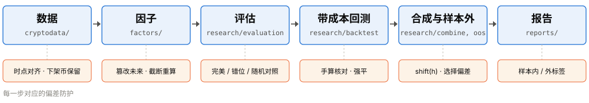
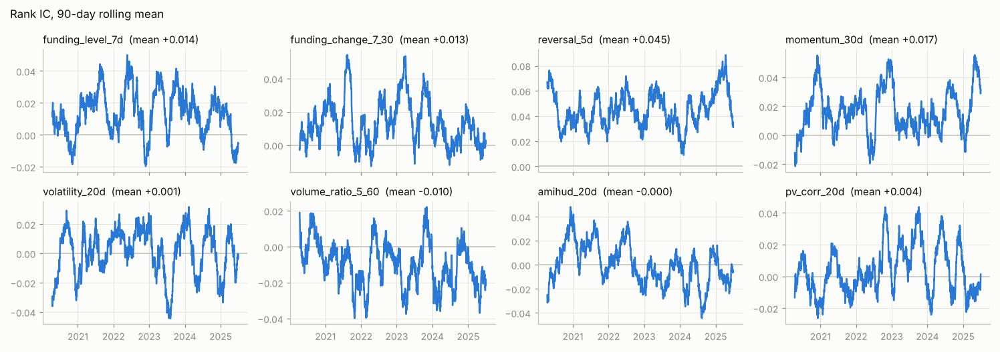
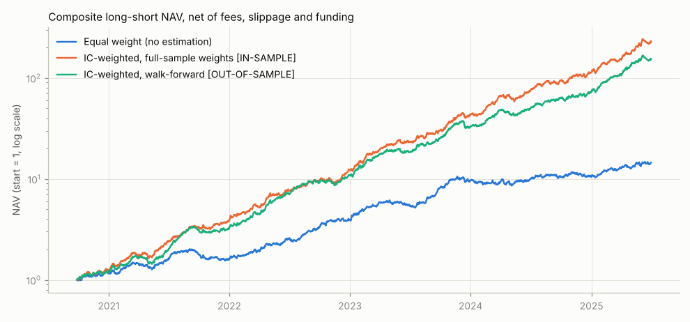
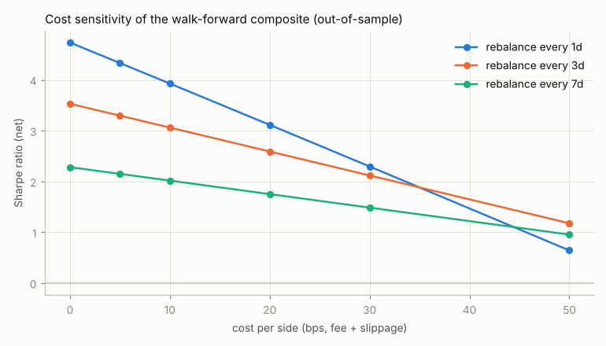

> **【合成数据警示】** 本仓库全部结果来自 `cryptodata/synthetic.py` 生成的合成数据，因子信号是人为植入的。手册里出现的每一个 IC、收益、夏普，只说明"流程能否找回植入的信号"，**不代表真实市场表现**。真实数据下载代码（`cryptodata/download.py`）至今没有端到端运行过。
>
> **数字来源标记**：**[R]** `reports/sample_synthetic/report.md`（2026-10-23 提交的示例报告）；**[P]** `docs/PROGRESS.md`；**[D]** `docs/DECISIONS.md`；**[C]** 源码常量或测试；**[W]** 本次用 `wc -l` / `grep` 对仓库做的静态统计。本次没有重跑流程，原因见附录第 1 条。

## 1 一页概览

这个项目能回答的问题是："给我一份永续合约日线和资金费数据，我能否不带未来函数、不带幸存者偏差地算因子、评估、扣成本回测，并诚实地区分样本内和样本外？" 它目前**不能**回答"哪个因子在真实市场有效"。

| 项目 | 规模 | 来源 |
|-------------|----------------------------------------------------------------------|-----------------|
| 源码 | 2,050 行 / 27 个 `.py`：`cryptodata` 882、`factors` 158、`research` 579、`reports` 431 | [W] |
| 测试 | 595 行，**67 个测试**：数据 14、因子 33（8 因子 × 4 类 + 1）、评估 8、回测 6、合成 5、报告 1 | [W][P] |
| 前视标记 | 源码中 14 处 `# [前视]` 注释，逐处说明为什么只用到当时可得的信息 | [W] |
| 因子 | 8 个（价格 3、成交量 2、量价 1、资金费 2），统一接口 `f(panel) -> 日期×标的` | [C] |
| 示例数据 | 150 个合成标的，其中 43 个在样本期内下架；2020-01-01 ~ 2025-06-30；股票池为流动性前 50 | [R] |
| 依赖 | numpy、pandas、pyarrow、scipy、matplotlib、pytest；下载只用标准库 `urllib` | [C] |

三条贯穿全项目的设计原则：(1) **一个时点约定管到底**，因子、股票池、标签、回测都按同一条规则对齐；(2) **每条防线都有会失败的测试**，而不只是注释；(3) **样本内/外标签由代码生成**，报告里每条结论自带标签，测试会检查。

## 2 数据层 `cryptodata/`

数据层不依赖因子和研究模块，可单独导入（`from cryptodata import load_panel, liquidity_universe`）。合成器与下载器产出**同一套原始列**，之后走同一条 清洗 → parquet → 面板 流程。

| 主题 | 约定 | 为什么这样定 | 代码 / 测试 |
|-----------|---------------------------------|---------------------------|-----------------------------|
| Binance 文件 | `data/futures/um/monthly/klines/<SYM>/1d/<SYM>-1d-<YYYY-MM>.zip`，资金费在 `.../fundingRate/<SYM>/`；每个 zip 旁有 sha256 `.CHECKSUM`；K 线 12 列，资金费 3 列 | 表结构集中在 `schema.py`，换数据源只需产出这些列 | `download.py`、`schema.py`；`test_synthetic_has_exact_binance_schema` |
| 文件差异 | 新文件有表头、老文件没有；时间戳毫秒或微秒（按数量级判断）；老资金费文件缺间隔列时按 8 小时 | 这些差异在真实历史文件里并存 | `download._has_header`、`align.epoch_to_utc`；`test_parse_binance_csv_with_and_without_header`、`test_epoch_units_ms_and_us` |
| 时点约定 | 日线用开盘日期 d 标识，覆盖 [d 00:00, d+1 00:00) UTC。**"日期 d 的信息" = d+1 00:00 UTC（d 收盘）时已可得的信息** | 因子、股票池、调仓的时点统一；任何一处对不齐就是前视 | `align.py` 模块说明 |
| 资金费归属 | 结算时刻落在 **(d 00:00, d+1 00:00]** 的费率归属日线 d，按日求和成 `funding` | d 开盘建仓、持有到 d 收盘，经历的正是 08:00、16:00、次日 00:00 三次结算；价格收益和资金费描述同一段持仓，可直接相加 | `align.funding_bar_date`（先减 1 毫秒再向下取整到天）；`test_funding_bar_date_rule` |
| 时间戳取整 | 结算时间先四舍五入到整分钟 | 真实数据带几毫秒抖动（如 00:00:00.004），不取整就无法去重，也会被归到错误的一天 | `align.round_funding_time` |
| 缺失与坏数据 | 存储层**不填充**价格；坏 K 线（价格非正、high/low 矛盾、负成交量）数值置 NaN 但保留行；只在首末日之间补齐日历 | ffill 会伪造"零波动、零成交"的日子，扭曲波动率和成交额因子 | `clean.py`；`test_missing_day_is_nan_not_filled`、`test_duplicates_and_invalid_rows` |
| 缺口收益 | `r_d = close_d / 上一个有效收盘 − 1`，最多回溯 3 天；缺失当天收益为 NaN | `pct_change` 会让缺口后那天变 NaN，持仓盈亏凭空消失 | `loader.compute_returns`；`test_returns_bridge_missing_day` |
| 流动性股票池 | 当天有收盘价、有效交易日累计 ≥ 60、过去 30 天平均成交额排名前 N；只用到 d 收盘为止的数据 | 小币滑点不可实现；新币初期行为异常且因子需要回看窗口 | `universe.liquidity_universe`；`test_universe_has_no_lookahead` |
| 下架币 | 标的列表来自 S3 目录列举（含已下架），不是交易所"当前交易对"接口；面板默认读入全部标的 | 只研究活下来的币会系统性高估收益 | `download.list_um_symbols`；`test_delisted_symbols_remain_in_history`、`test_universe_contains_delisted_before_delisting` |
| 下架标记 | `status=DELISTED` 当最后一根 K 线早于全局末日 3 天以上。这张元数据表含未来信息，**只用于描述，不用于筛选** | 用"最终是否下架"筛选就是前视 | `store.build_symbol_meta` |
| 内存 | 每个标的一个 parquet、数值列 float32、过滤条件下推；面板预计超过 1 GB 直接报错 | 本地约 5 GB 内存 | `store.py`、`loader._check_memory`；`test_memory_guard` |

幸存者偏差要在四处同时处理才算完整：**数据**（下架币留在历史里）、**股票池**（下架前照常可入选）、**标签**（下架后收益按 0，相当于在最后价格平仓，而不是让该币从评估里消失）、**回测**（连续 3 天无报价强制平仓并计成本）。

## 3 八个因子 `factors/`

所有因子在 d 收盘计算，只用 d 及以前的数据；当天无有效价格处统一为 NaN（`base.finalize`）。记号：r 为日简单收益，QV 为 USDT 成交额，F 为按日汇总的资金费率。"方向"是**看数据之前**按文献和直觉定的先验（+1 表示值越大预期收益越高）；用样本 IC 的符号来定方向本身就是过拟合。

| 因子 | 公式（d 日） | 方向 | 经济直觉 | 合成数据里是否植入 |
|-------------------|---------------------------|------|----------------------------|--------------------|
| `reversal_5d` | −Σ ln(1+r)，最近 5 天 | +1 | 短期过度反应与流动性冲击之后回落 | 是，强度 0.025 |
| `momentum_30d` | Σ ln(1+r)，d−29 到 d−5 共 25 天（跳过最近 5 天） | +1 | 中期趋势延续；跳过近期以避开反转 | 是，强度 0.02 |
| `volatility_20d` | std(r)，20 天 | −1 | 低波动异象：高波动资产长期收益偏低 | 否 |
| `volume_ratio_5_60` | ln( mean(QV,5) / mean(QV,60) ) | −1 | 突然放量常伴随过度关注，之后偏弱 | 否（合成数据上方向相反） |
| `amihud_20d` | ln( mean(\|r\|/QV, 20) ) | +1 | 越不流动，要求的补偿越高 | 否 |
| `pv_corr_20d` | corr(r, ln QV)，20 天 | −1 | "放量上涨"多的币后续倾向反转 | 否 |
| `funding_level_7d` | mean(F, 7) | −1 | 费率高 = 多头拥挤，易踩踏，且多头持续付费 | 是，强度 0.03 |
| `funding_change_7_30` | mean(F,7) − mean(F,30) | −1 | 拥挤度正在快速上升 | 间接（同一个拥挤度变量） |

用成交额的相对变化代替换手率，是因为加密货币缺少可靠的流通量数据 [D]。植入强度的单位是"特异波动率的倍数"（`SyntheticConfig`）[C]。

**需要主动向面试官说明的一点**：合成器植入反转用的是过去 5 天、动量用的是 d−30 到 d−5，与 `reversal_5d` 和 `momentum_30d` 的窗口完全一致。所以这些因子"有效"是按构造成立的，只能证明评估链路没有把信号弄丢或弄反。

## 4 评估方法 `research/evaluation.py`

评估的基本单位是"某一天的横截面"：每天单独比较因子排序和未来收益排序，再在时间上平均，全市场一起涨跌不影响结论。标签是从 d 收盘持有到 d+h 收盘的复利收益（`labels.forward_returns`），这是项目里**唯一有意使用未来数据的函数**，只允许用于评估。

| 指标 | 定义 | 实现细节与理由 | 代码 |
|----------|----------------------------|------------------------------------|--------------------------|
| IC | 当日因子值与未来收益的横截面 Pearson 相关 | 向量化逐行相关；与 scipy 逐行核对（`test_rowwise_corr_matches_scipy`） | `ic_series`、`rowwise_corr` |
| RankIC | 先排名再算相关（Spearman），**主指标** | 加密收益肥尾，一个极端值就能主导 Pearson | `ic_series(method="rank")` |
| ICIR | IC 均值 / IC 标准差 | 衡量是否稳定有效；均值高但忽正忽负的因子不可靠 | `ic_summary` |
| t 值 | ICIR × √(n/h) | 持有期 h>1 时相邻标签重叠，IC 自相关，有效样本数近似为 n/h；比 Newey-West 粗糙但好讲 | `ic_summary` |
| IC 衰减 | 持有期 1、2、3、5、10、20 天的平均 RankIC | 衰减快 = 信号短命 = 需要高频调仓 = 成本高 | `ic_decay` |
| 分组回测 | 每天在股票池内按因子分 5 组，组内等权持有 1 天；LS = 第 5 组 − 第 1 组，不含成本 | 看单调性，比单一相关系数更能暴露"只有尾部有效" | `quantile_returns` |
| 换手 | 排名自相关（今天与昨天排名的相关）和最高组成分换手 | 前者衡量信号稳定性，后者直接对应交易量 | `rank_autocorr`、`top_group_turnover` |
| 因子相关性 | 逐日横截面 Spearman 相关再对时间平均 | 高相关因子合成时信息重复，等权会变相加权 | `factor_corr_matrix` |

横截面有效标的少于 10 个的日子不计算 IC（`MIN_NAMES`）[C]。

## 5 回测引擎 `research/backtest.py`

按名义价值逐日记账：`NAV` 为净值，`q_i` 为标的 i 的持仓名义价值（多正空负）。每天 t 依次执行：(1) 价格盈亏 `Σ q_i·r_i`；(2) 资金费 `Σ q_i·F_i`，从 NAV 扣除，多头在正费率时付费、空头收取；(3) 持仓随价格漂移 `q_i ← q_i(1+r_i)`；(4) 若为调仓日，调到 `w_i·NAV` 并扣成本。目标权重 `weights.loc[t]` 只能由 t 收盘及以前的信息算出，成交在 t 收盘，赚到的是 t+1 及以后的收益。

| 要素 | 处理方式 | 默认值 / 已知近似 |
|------------|----------------------------------------------|------------------------------------------|
| 手续费 | 成交额 × taker 费率 | 0.05%（Binance U 本位普通用户 taker）[C] |
| 滑点 | 成交额 × 固定比例 | 0.05%；**没有**按成交额/日均成交额建模冲击 [P] |
| 资金费 | 当天开始时的名义价值 × 当天结算费率之和 | 忽略日内价格变动对结算名义价值的影响（二阶小量）[P] |
| 调仓频率 | `rebalance_every`；非调仓日持仓自然漂移 | 默认每天；不隐含"每天免费再平衡" |
| 执行延迟 | `execution_lag=L`：t 日执行 t−L 日的信号 | 默认 0（信号当天收盘价成交），与 IC 评估时点一致 |
| 下架强平 | 持仓标的连续 3 天无价格，按最后价格平仓并计成本 | 只依赖"已经 3 天没报价"这一过去信息，不偷看是否会下架 |
| 组合 | 最高组做多、最低组做空，各 50% 名义，组内等权 | 美元中性，剥离市场方向（`test_long_short_weights_are_dollar_neutral`） |
| 指标 | 年化按 365 天；夏普不扣无风险利率 | 7×24 交易，USDT 无统一的无风险利率 [D] |

**手算核对**（`tests/test_backtest.py::test_hand_calculated_long_short_with_funding`，费率 0.04% + 滑点 0.01%，每 2 天调仓）[C]：

| 日 | 事件 | 计算 | NAV |
|------|------------------------------|------------------------------------------------------|----------|
| 0 | 收盘建仓：多 A 0.5、空 B 0.5 | 成交额 1.0，成本 1.0 × 0.05% = 0.0005 | 0.9995 |
| 1 | A +10%，B +5%；资金费 A +0.03%、B −0.02% | 盈亏 0.5×10% − 0.5×5% = +0.025；资金费 0.5×0.0003 + (−0.5)×(−0.0002) = 0.00025（两边都在付） | 1.02425 |
| 2 | A −10%，B 不动；调仓日全部平仓 | 持仓已漂移到 A 0.55、B −0.525；盈亏 0.55×(−10%) = −0.055；成交额 0.495 + 0.525 = 1.02，成本 0.00051 | 0.96874 |
| 3 | 空仓 | — | 0.96874 |

另有一条交叉验证：零成本、不计资金费、每日调仓时，回测日收益必须等于 0.5 × 分组回测的 LS 收益（错后一天），容差 2e-6（`test_zero_cost_backtest_matches_quantile_ls`）。两套独立写出的代码互相印证。

## 6 偏差防护（本手册的重点）

| 防线 | 防什么 | 怎么测 | 代码位置 |
|--------------|-------------------|---------------------------------------|----------------------------|
| 前视测试（篡改未来） | 因子用到了 d 之后的数据 | 把第 400 天起的**所有原始字段**乘以 1e3~1e5 的随机数，或全部置 NaN；此前每一天的因子值必须逐位相同。同时反向断言篡改之后的值确实变了，否则测试是空转。8 因子 × 2 种篡改 = 16 个用例 | `tests/test_factors.py::test_no_lookahead` |
| 截断测试（时点一致性） | 全样本统计量泄漏，例如用全样本均值做标准化 | 只用截至 d 的数据重算 d 的因子值，必须与全样本算出的 d 值一致。8 个用例 | `test_point_in_time_truncation` |
| 股票池前视 | 用未来成交额或事后下架信息筛选 | 把未来成交额改成 1e12，此前的股票池不变 | `tests/test_data.py::test_universe_has_no_lookahead` |
| 对照 ①：完美因子 | 评估代码本身有 bug，给不出该有的高分 | 直接把未来收益当因子：RankIC 每天 > 0.999，五组收益严格单调，LS 每天为正 | `tests/test_evaluation.py::test_perfect_factor_gets_extreme_ic` |
| 对照 ②：错位一天 | 因子和标签错位一天这类最常见的对齐 bug | 把完美因子 `shift(1)`，平均 RankIC 的绝对值必须 < 0.1 | `test_perfect_factor_lagged_one_day_is_useless` |
| 对照 ③：随机因子 | 评估流程凭空制造显著性 | 纯噪音因子：\|平均 RankIC\| < 0.02 且 \|t\| < 3 | `test_random_factor_has_zero_ic` |
| 完美因子隔离 | 作弊因子混进正式因子库 | 注册表里没有名字含 perfect/future 的因子；因子源码不出现 `forward_returns`，也不出现负向 `shift` | `test_perfect_factor_not_in_library` |
| walk-forward 权重 | 用"标签尚未实现"的 IC 定权重 | 日期 s 的 IC 要到 s+h 收盘才知道，所以**先 `shift(h)` 再滚动**。篡改第 k 天起的 IC，t < k+h 的权重不变，t = k+h 才开始变 | `research/combine.py::rolling_ic_weights`；`tests/test_combine.py::test_rolling_weights_use_only_lagged_ic` |
| walk-forward 合成信号 | 整条合成链路里藏着泄漏 | 篡改未来后，此前的 walk-forward 合成值逐位相同；作为对照，全样本权重的合成值**确实变了**，证明测试有分辨力 | `test_walk_forward_composite_has_no_lookahead` |
| 训练/测试间隔 | 训练集最后一天的标签跨过切分日 | 训练集截止到切分日前 2 天（purge） | `research/oos.py::split_study`、`research/overfit.py` |
| 选择偏差实验 | 试了很多候选，只报告最好的 | 在 20 个参数变体 + 40 个 AR(1) 纯噪音因子里按训练集 RankIC 挑 Top-5，再看测试集。测试断言：挑出的噪音因子训练集 IC 为正、测试集更低，噪音整体测试集 \|IC\| < 0.01 | `research/overfit.py`；`test_selection_bias_noise_factors` |
| 同区间比较 | 样本内外差异其实来自市场环境不同 | 等权、全样本 IC 加权、walk-forward 三者在同一段样本外区间评估 | `research/oos.py::walk_forward_study` |
| 结论标签 | 报告把样本内结果当成结论 | 结论文字由代码按数字生成；测试检查每条结论都带【样本内】或【样本外】 | `reports/markdown.py`；`tests/test_report.py` |

读法：前三行防**因子与股票池**的前视，中间四行验证**评估器本身**，后六行防**合成与挑选**阶段的过拟合。三种对照缺一不可：完美因子证明"有信号时测得出"，随机因子证明"没信号时不会无中生有"，错位一天证明"时点没对错"。

## 7 合成数据上的结果

> **【合成数据警示】** 本节所有数字来自 [R]（与 [P] 一致），生成它们的数据中反转、动量、资金费三种信号是人为写进去的，且强度在 5 年里恒定。这些数字只回答一个问题：**流程能否找回植入的信号，并且不在没植入的地方报告信号**。它们不代表真实市场表现，不能作为"因子有效"的证据引用。

**单因子（全样本，属于样本内；合成数据，仅验证流程）**

| 因子 | 是否植入 | RankIC | t 值 | 排名自相关 | 流程是否给出预期答案 |
|----------------------|----------|-----------|---------|--------------|----------------------------------|
| `reversal_5d` | 是 | 0.0445 | 13.03 | 0.740 | 是，找回 |
| `momentum_30d` | 是 | 0.0165 | 4.84 | 0.942 | 是，找回 |
| `funding_level_7d` | 是 | 0.0136 | 4.15 | 0.984 | 是，找回 |
| `funding_change_7_30` | 间接 | 0.0132 | 3.99 | 0.974 | 是 |
| `volatility_20d` | 否 | 0.0011 | 0.32 | 0.970 | 是，不显著 |
| `amihud_20d` | 否 | −0.0002 | −0.07 | 0.994 | 是，不显著 |
| `pv_corr_20d` | 否 | 0.0036 | 1.11 | 0.931 | 是，不显著 |
| `volume_ratio_5_60` | 否 | −0.0100 | −2.98 | 0.788 | **未解释**：没有植入却显著为负，见附录第 6 条 |

**合成与样本外（合成数据，仅验证流程）**：同一段样本外区间（2020-09-27 起），多空组合，每日调仓，单边 0.05% 手续费 + 0.05% 滑点，计资金费。

| 合成方式 | 标签 | RankIC | 夏普 | 最大回撤 | 日换手 |
|------------------------------|------------|------------|----------|----------------|--------------|
| 等权（不估计参数） | — | 0.0260 | 2.26 | −22.9% | 49.2% |
| IC 加权，全样本权重 | 样本内 | 0.0492 | 4.21 | −14.0% | 66.8% |
| IC 加权，walk-forward | 样本外 | 0.0443 | 3.93 | −17.8% | 63.4% |

这张表该怎么读：

- **样本内高于样本外（4.21 对 3.93）**，方向符合预期，说明 walk-forward 确实拿掉了一部分"用未来定权重"的虚高。
- **差距很小是合成数据的产物**，因为植入信号是平稳的，从过去估计的权重在未来同样适用 [P]。真实市场里因子会衰减、会换方向，差距通常大得多。
- **夏普 3.93 本身不可信**。这样的数字在真实的日频多空策略里几乎见不到，它反映的是植入强度，不是市场。

**选择偏差实验（合成数据，仅验证流程）**：只在 40 个噪音因子里挑 Top-5，训练集平均 IC +0.0060，同一批在测试集 −0.0042；在全部候选里挑，训练集 0.0337，测试集 0.0343。噪音因子的"有效"来自运气，样本外消失。这个实验在合成数据上依然成立，因为它展示的是统计规律，不依赖市场。

**成本敏感性（walk-forward 合成因子，样本外；合成数据，仅验证流程）**：默认设置下日换手 63%，手续费与滑点各年化 11.6%。这与手算一致：63.4% × 0.05% × 365 ≈ 11.6%。单边 10 bp 时每日调仓夏普最高（3.93）；到 50 bp 时每日调仓降到 0.64，每 3 天调仓变成最优（1.17）。可迁移的结论是这个机制本身：成本越高，降低调仓频率越划算。具体数值不可迁移。

**为什么调低了植入强度** [D]：初版合成器里，反转因子扣成本后的夏普约为 5，远不真实，容易让读者把合成结果误当成研究发现。Phase 4 把强度调到反转 0.025、动量 0.02、资金费 0.03。调低之后合成因子样本外夏普仍有 3.93，所以结论没有变：这些数字只能用来检验流程。调低前的原始取值没有记录在仓库里。

## 8 局限与切换到真实数据的检查清单

**已知局限** [P]：只有日线；滑点为固定比例；资金费按当天开始时的名义价值计；t 值用 n/h 近似；合成信号平稳导致样本内外差距偏小；真实下载从未运行。

**切换命令**：先 `python -m cryptodata.build --source binance --root data --symbols BTCUSDT ETHUSDT SOLUSDT` 试少量标的，再去掉 `--symbols` 跑全部。下游命令不变。

| 阶段 | 预期会遇到的问题 | 检查项 |
|------------|----------------------------------------------|------------------------------------------|
| 下载 | S3 列目录、翻页（`NextMarker`）、`.CHECKSUM` 格式都没有在线验证；逐文件顺序下载，全市场约 500+ 个合约 [P] 会很慢 | 先跑 3 个标的；确认缓存目录 `data/raw/` 可断点续传；记录首次报错并回填 `docs/BLOCKERS.md` |
| 下载 | 只取月度文件，最近一个未结束的月份缺失 | 确认面板末日；需要最新数据时补充日度文件 |
| 标的 | 过滤规则只是"以 USDT 结尾且不含下划线"；指数类合约、1000 倍面值合约、改名或代码复用的合约都会进来 | 人工浏览标的列表；决定指数类合约是否剔除并记入 `DECISIONS.md` |
| 清洗 | 真实脏数据的类型与合成器注入的不同 | 阅读 `data/meta/clean_report.csv`；抽 3 个标的与交易所页面核对收盘价和资金费 |
| 清洗 | 缺口超过 3 天时，缺口后首日收益为 NaN，回测里按 0 计，这段盈亏会丢 | 统计长缺口的数量；必要时调整 `max_gap` 或单独处理 |
| 资金费 | 结算间隔有 8 小时和 4 小时，可能还有更短的；早期文件可能缺失；超过 ±5% 的费率会被当脏数据删除 | 检查 `funding_count` 的分布；确认有价格的日子资金费覆盖率 |
| 下架 | 判定依赖"早于全局末日 3 天"；真实下架按结算价交割，回测按最后收盘价平仓 | 确认下架数量大于 0 且量级合理；抽查几个已知下架的合约 |
| 股票池 | 早期合约数量少，前 50 可能凑不满，每组不足 10 个 | 画出每日股票池大小；考虑缩小 `top_n` 或推迟起始日 |
| 研究 | 真实 IC 会小得多且不稳定，方向可能与先验相反；样本内外差距会变大 | **先冻结因子列表、参数和先验方向，再看真实数据**；记录试过的全部候选数 |
| 研究 | 肥尾与极端事件会主导 Pearson IC 和回撤 | 以 RankIC 为主；检查单日极端收益对结果的贡献 |
| 回测 | 10 bp 单边成本对小币偏乐观；收盘价成交不现实 | 跑 `execution_lag=1` 的对比；做成本敏感性；估算容量 |
| 回测 | 没有保证金、强平、持仓上限 | 在结论里写明这是无杠杆约束的纸面组合 |
| 流程 | 文档还写着"仅合成数据" | 重跑 67 个测试；重新生成报告；更新 `PROGRESS.md` 和本手册第 7 节 |

## 9 面试 Q&A

**Q1. 你的结果是真的吗？**\
不是市场结论。数据是我自己写的生成器造的，反转、动量、资金费三种信号是按公式植入的，窗口还和因子定义一致，所以因子"有效"是按构造成立的。这些数字能证明的是流程正确：植入的信号被找回，没植入的因子不显著，完美因子 RankIC 接近 1，错位一天后归零，walk-forward 低于样本内。真实数据的下载代码写了但没有端到端跑过。我能负责的是基础设施和偏差防护，不是任何一个因子在真实市场的表现。下一步是冻结因子列表后接入真实数据。

**Q2. 日线因子什么时刻可以计算？用什么价格成交？**\
日线用开盘日期 d 标识，d 的收盘价在 d+1 00:00 UTC 才确定，所以"日期 d 的信息"指这个时刻已可得的信息。默认假设用 d 收盘价成交，这是日频研究的常见约定，但偏乐观；`execution_lag=1` 可以推迟一天成交来测敏感性。见 `cryptodata/align.py`、`research/labels.py`。

**Q3. 资金费和 K 线怎么对齐？为什么左开右闭？**\
结算时刻在 (d 00:00, d+1 00:00] 的归日线 d。d 开盘建仓、收盘平仓，经历的是 08:00、16:00、次日 00:00 三次结算；d 00:00 那次发生在建仓瞬间，不参与。这样价格收益和资金费描述同一段持仓。实现是先减 1 毫秒再向下取整。见 `align.funding_bar_date`。

**Q4. 怎么证明因子没有未来函数？**\
两种互补的测试。篡改测试：把某天之后的所有原始数据改成极端值或 NaN，此前的因子值必须逐位不变，并反向断言之后的值变了。截断测试：只用截至 d 的数据重算，d 的值必须与全样本一致。8 个因子自动参数化，新增因子自动覆盖。见 `tests/test_factors.py`。

**Q5. 怎么验证评估代码本身是对的？**\
三种对照。完美因子（未来收益本身）必须得到 RankIC > 0.999 和单调分组；错位一天后必须接近 0；随机因子必须不显著。另外，零成本回测必须等于 0.5 倍的分组多空收益，两套代码互相印证。见 `tests/test_evaluation.py`、`tests/test_backtest.py`。

**Q6. IC 和 RankIC 的区别？为什么主看 RankIC？**\
IC 是因子值与未来收益的 Pearson 相关，RankIC 是排名后的 Spearman 相关。加密收益肥尾，一个暴涨几倍的币就能主导 Pearson。两者同时报告，以 RankIC 为主。见 `evaluation.ic_series`。

**Q7. 持有期大于 1 天时 t 值为什么要调整？**\
相邻两天的 h 日标签共享 h−1 天收益，IC 序列自相关，直接用 n 会高估显著性。这里把有效样本数近似为 n/h。更严格的做法是 Newey-West，我选了更容易讲清的近似，并记在 `DECISIONS.md`。

**Q8. 幸存者偏差怎么处理？**\
四处：标的列表来自含下架合约的目录；股票池每天动态筛选，下架前可入选；标签在下架后按 0 收益计，不让暴跌下架的币从评估里消失；回测对连续 3 天无报价的持仓强平并计成本。元数据里的"是否下架"含未来信息，只用于描述。

**Q9. 数据缺一天怎么办？为什么不 ffill？**\
存储层保留 NaN。ffill 会造出"零波动、零成交"的假日子，扭曲波动率和成交额因子。收益率用上一个有效收盘价做分母（最多回溯 3 天），缺口期间的涨跌记在缺口后第一天，复利总收益与价格一致。见 `loader.compute_returns`。

**Q10. 回测里资金费怎么算？谁付钱？**\
费率为正时多头付给空头，为负时相反，金额是持仓名义价值乘费率。回测每天用当天开始时的名义价值乘当天各次结算费率之和。手算例子里多头在正费率下付 0.00015，空头在负费率下付 0.0001，合计 0.00025。近似之处是忽略了日内价格变动。

**Q11. IC 加权时为什么先 `shift(h)` 再滚动？**\
日期 s 的 IC 需要 s 到 s+h 的收益，到 s+h 收盘才知道。在 t 日只能用 s ≤ t−h 的 IC。少了这一步，权重里就混进了尚未实现的标签，是很隐蔽的未来函数。测试通过篡改 IC 序列验证权重恰好从 k+h 开始变化。见 `combine.rolling_ic_weights`。

**Q12. 试了很多参数和因子，怎么知道挑出来的不是运气？**\
选择偏差实验把 40 个纯噪音因子混进候选，按训练集 IC 挑 Top-5，再看测试集。噪音里挑出来的在训练集看着为正，测试集归零。对应的纪律是：先验方向在看数据前定好，记录试过的候选总数，用 walk-forward 和留出间隔的切分做样本外检验。目前没有做多重检验校正，这是缺口。

**Q13. 样本内外差距从哪来？你这里为什么这么小？**\
差距来自权重和挑选利用了评估区间的信息。这里夏普 4.21 对 3.93，差距小是因为合成信号平稳，过去估计的权重在未来同样适用。真实因子会衰减和换向，差距通常大得多。所以我不会把"差距小"当成结论。

**Q14. 调仓频率怎么选？成本影响多大？**\
看成本敏感性表。合成数据上单边 10 bp 时每日调仓最优，50 bp 时每 3 天最优。可迁移的是机制：成本升高时，少交易省下的成本超过信号变旧损失的收益。日换手 63% 乘 10 bp 乘 365 天，约每年 23% 的成本拖累，高换手因子的纸面收益很容易被吃掉。

**Q15. 如果再给你两周，先做什么？**\
第一，跑通真实下载并核对几个标的。第二，在看真实数据之前冻结因子、参数和方向。第三，补执行延迟敏感性和按成交额建模的滑点。第四，给整个流程加上多重检验校正和留出期。

## 10 附录：缺口清单

1. **本次没有重跑测试和流程。** 当前容器里没有安装 scipy、pyarrow、matplotlib、pytest，而任务规定不安装网络包。因此"67 个测试"来自 [P] 的记录和本次对测试函数与参数化的静态清点（14 + 33 + 8 + 6 + 5 + 1），不是本次运行结果；第 7 节的数字和图全部来自已提交的示例报告 [R]。
2. **真实下载未验证。** 本次只对 `https://data.binance.vision/` 做了一次 `curl`，返回 HTTP 200，按要求没有下载任何数据；S3 列目录接口没有测试。
3. **文档与现状不一致。** `PROGRESS.md` 和 `BLOCKERS.md` 记录的是当时代理返回 403；本次环境可以访问根地址。两份文档未更新（本次任务不改现有文件）。
4. **报告文字与代码不一致。** `reports/markdown.py` 把选择偏差实验写成"26 个参数变体"，而 `research/overfit.py::_variants` 实际生成 20 个（反转 8、动量 5、资金费 4、低波动 3）。本手册采用代码里的 20；[R] 和 [P] 里仍是 26。
5. **调低前的植入强度没有记录**，只有调低后的取值和"初版夏普约 5"的描述 [D]。
6. **合成数据上有两处未解释的现象。** `volume_ratio_5_60` 没有植入却显著为负（t = −2.98）；`volatility_20d` 的 RankIC 随持有期从 0.0011 升到 0.0444（20 天）。仓库没有给出解释，可能是生成过程的副产品，本手册没有验证。
7. **示例报告的新鲜度无法确认。** [R] 提交于 2026-10-23，本次无法重跑来确认它与当前代码逐位一致。
8. **缺少的分析**：执行延迟敏感性表、多重检验校正、Newey-West、按成交额建模的冲击成本、小时线、保证金与强平。
9. **没有持续集成**，测试只能手动运行。
10. `CLAUDE.md` 仍提到 `docs/LEARNING_GUIDE.md`，该文件已拆分到 `learning/`。
