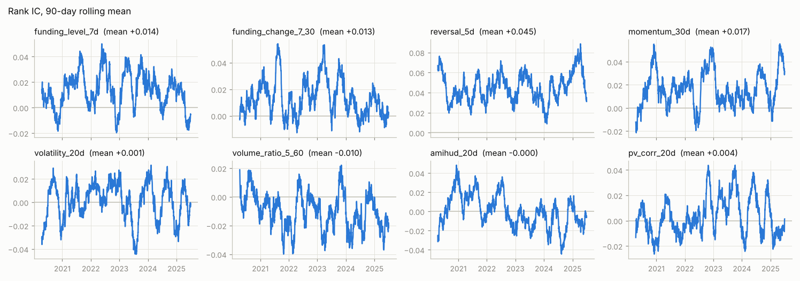
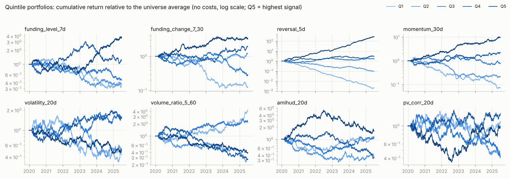
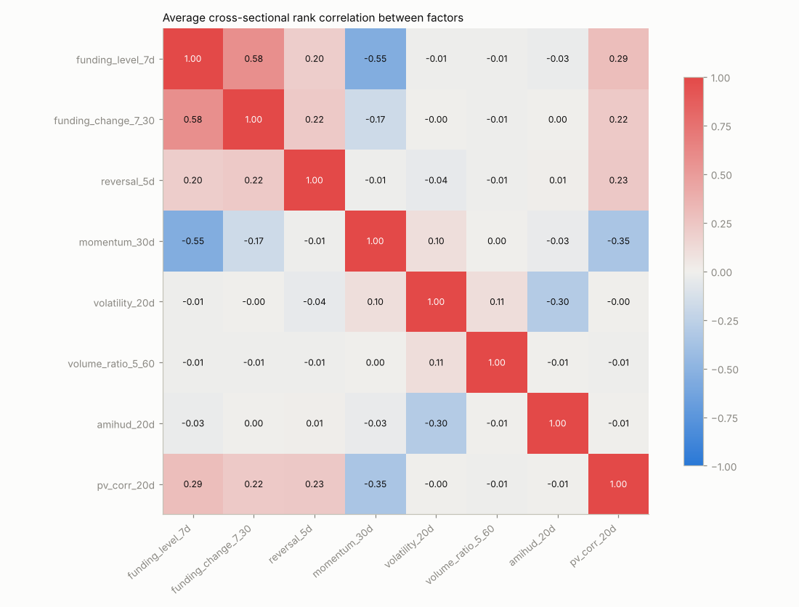
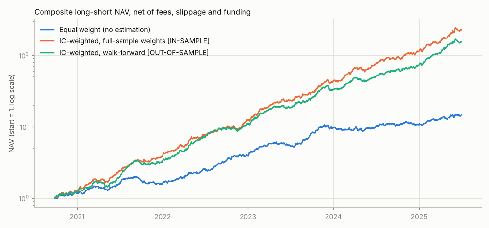
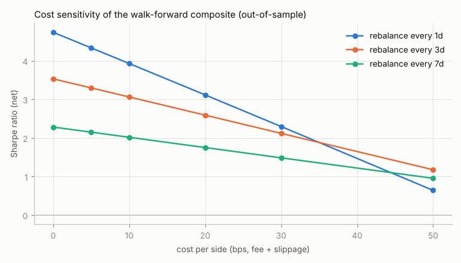

# 加密货币横截面因子研究报告

标签说明：【样本内】 = 评估数据参与了因子挑选或参数估计，结果偏乐观；【样本外】 = 评估区间的数据没有参与任何估计。

## 1. 数据概况

> ⚠️ **本报告基于合成数据**（`cryptodata/synthetic.py`），数据里人为植入了反转、动量、资金费率三种弱信号。所有数字只用于验证研究流程是否正确，**不代表真实市场规律**。切换到真实数据见 `docs/PROGRESS.md`。

- 数据源：`synthetic`；区间 2020-01-01 ~ 2025-06-30
- 标的总数 150（其中 **43 个在样本期内下架**，全部保留在研究样本中以避免幸存者偏差）
- 股票池：每天按过去 30 天平均成交额取前 50 名（上市满 60 天），平均每天 50.0 个标的

## 2. 单因子评估 【样本内】

所有因子已按先验方向调整符号（值越大预期收益越高）。统计区间为全样本，属于样本内结果。
LS_ann / LS_sharpe 为 Q5−Q1 多空组合（不含成本）的年化收益和夏普。

| 因子 | IC | RankIC | ICIR | t | LS_ann | LS_sharpe | rank_autocorr | top_turnover |
|---|---|---|---|---|---|---|---|---|
| funding_level_7d | 0.0087 | 0.0136 | 0.094 | 4.15 | 45.7% | 0.85 | 0.984 | 10.1% |
| funding_change_7_30 | 0.0095 | 0.0132 | 0.090 | 3.99 | 61.8% | 1.19 | 0.974 | 12.7% |
| reversal_5d | 0.0432 | 0.0445 | 0.295 | 13.03 | 221.3% | 3.81 | 0.740 | 35.1% |
| momentum_30d | 0.0171 | 0.0165 | 0.110 | 4.84 | 91.3% | 1.64 | 0.942 | 17.9% |
| volatility_20d | 0.0012 | 0.0011 | 0.007 | 0.32 | -1.5% | -0.03 | 0.970 | 11.7% |
| volume_ratio_5_60 | -0.0120 | -0.0100 | -0.068 | -2.98 | -45.8% | -0.88 | 0.788 | 35.6% |
| amihud_20d | 0.0004 | -0.0002 | -0.002 | -0.07 | 8.1% | 0.15 | 0.994 | 10.0% |
| pv_corr_20d | 0.0016 | 0.0036 | 0.025 | 1.11 | -2.7% | -0.05 | 0.931 | 17.6% |

### IC 衰减（不同持有期的平均 RankIC）【样本内】

| 因子 \ 持有期(天) | 1 | 2 | 3 | 5 | 10 | 20 |
|---|---|---|---|---|---|---|
| funding_level_7d | 0.0136 | 0.0146 | 0.0153 | 0.0110 | 0.0020 | -0.0014 |
| funding_change_7_30 | 0.0132 | 0.0137 | 0.0133 | 0.0083 | 0.0012 | -0.0045 |
| reversal_5d | 0.0445 | 0.0494 | 0.0498 | 0.0442 | 0.0180 | -0.0021 |
| momentum_30d | 0.0165 | 0.0233 | 0.0263 | 0.0328 | 0.0409 | 0.0479 |
| volatility_20d | 0.0011 | 0.0071 | 0.0125 | 0.0211 | 0.0343 | 0.0444 |
| volume_ratio_5_60 | -0.0100 | -0.0138 | -0.0141 | -0.0072 | -0.0066 | -0.0094 |
| amihud_20d | -0.0002 | -0.0026 | -0.0055 | -0.0064 | -0.0070 | -0.0127 |
| pv_corr_20d | 0.0036 | 0.0038 | 0.0028 | -0.0021 | -0.0159 | -0.0269 |

**结论**

- 【样本内】 与先验方向一致且显著（t>2）的因子：funding_level_7d, funding_change_7_30, reversal_5d, momentum_30d；其中 RankIC 最高的是 reversal_5d（0.045）。
- 【样本内】 显著但方向与先验**相反**的因子：volume_ratio_5_60——要么先验错了，要么这段样本有特殊性，需要样本外确认后才能改方向。
- 【样本内】 不显著（|t|≤2）的因子：volatility_20d, amihud_20d, pv_corr_20d，单独使用没有可靠的预测力。
- 【样本内】 换手最高的是 reversal_5d（排名自相关 0.74），交易成本对它的侵蚀最大。
- 【样本内】 reversal_5d 的 RankIC 在持有期 10 天时降到 1 天的一半以下，说明它的信息主要在这之前兑现。

## 3. 因子相关性 【样本内】

**结论**

- 【样本内】 相关性较高的因子对：funding_level_7d 与 funding_change_7_30：+0.58；funding_level_7d 与 momentum_30d：-0.55。高相关的因子在合成时信息重复，等权会变相给这类信号更高权重。

## 4. 因子合成：等权 vs IC 加权，样本内 vs 样本外

三种方法都在同一段样本外区间（2020-09-27 起）评估；多空组合，每日调仓，
扣除 0.05% 手续费 + 0.05% 滑点和资金费。walk-forward 窗口 365 天、每 30 天重估一次。

| 合成方式 | RankIC | ICIR | t | ann_return | sharpe | max_dd | turnover |
|---|---|---|---|---|---|---|---|
| 等权（无需估计） | 0.0260 | 0.177 | 7.39 | 75.3% | 2.26 | -22.9% | 49.2% |
| IC加权-全样本权重【样本内】 | 0.0492 | 0.328 | 13.67 | 213.9% | 4.21 | -14.0% | 66.8% |
| IC加权-walk-forward【样本外】 | 0.0443 | 0.295 | 12.28 | 188.6% | 3.93 | -17.8% | 63.4% |

权重（平均 RankIC，正负号表示使用方向）：

| 因子 | 全样本权重【样本内】 | walk-forward 最新一期权重 |
|---|---|---|
| funding_level_7d | 0.0136 | 0.0072 |
| funding_change_7_30 | 0.0132 | 0.0065 |
| reversal_5d | 0.0445 | 0.0579 |
| momentum_30d | 0.0165 | 0.0230 |
| volatility_20d | 0.0011 | -0.0015 |
| volume_ratio_5_60 | -0.0100 | -0.0142 |
| amihud_20d | -0.0002 | -0.0121 |
| pv_corr_20d | 0.0036 | -0.0019 |

**结论**

- 【样本内】 用全样本权重时，夏普 4.21、RankIC 0.0492。
- 【样本外】 用 walk-forward 权重时，夏普 3.93、RankIC 0.0443，
  比样本内低 0.28 个夏普单位——这就是"用未来数据估计权重"带来的虚高部分。
- 【样本外】 等权合成（不估计任何参数）夏普 2.26。

## 5. 成本敏感性 【样本外】

对象：walk-forward IC 加权合成因子的多空组合（样本外区间）。

| 单边成本 | 每 1 天调仓 | 每 3 天调仓 | 每 7 天调仓 |
|---|---|---|---|
| 0 bp | 4.73 | 3.53 | 2.28 |
| 5 bp | 4.33 | 3.29 | 2.15 |
| 10 bp | 3.93 | 3.06 | 2.02 |
| 20 bp | 3.11 | 2.59 | 1.75 |
| 30 bp | 2.29 | 2.12 | 1.48 |
| 50 bp | 0.64 | 1.17 | 0.95 |

**结论**

- 【样本外】 默认设置（每日调仓、单边 10bp）：年化 188.6%，夏普 3.93，
  最大回撤 -17.8%，日均换手 63%；
  手续费年化 11.6%、滑点 11.6%、资金费 -12.0%（负数表示净收入）。
- 【样本外】 单边成本 10bp 时，夏普最高的调仓频率是每 1 天（3.93）。在 50bp 以内的成本下各调仓频率夏普都为正（合成数据信号偏强，真实数据通常没这么乐观）。
- 【样本外】 单边成本 50bp 时，最优调仓频率变为每 3 天（夏普 1.17）。
  成本越高，降低调仓频率越划算：少交易省下的成本超过了信号变"旧"损失的收益。

## 6. 训练/测试切分与选择偏差

### 6.1 前半段训练、后半段测试（切分日 2022-10-01）

| 信号 / 区间 | RankIC | ICIR | t | ann_return | sharpe | max_dd | turnover |
|---|---|---|---|---|---|---|---|
| IC加权合成 / 样本内(训练集) | 0.0477 | 0.313 | 9.60 | 201.3% | 4.13 | -11.3% | 65.5% |
| IC加权合成 / 样本外(测试集) | 0.0462 | 0.314 | 9.95 | 181.1% | 3.73 | -16.0% | 64.6% |
| 训练集最优单因子(reversal_5d) / 样本内(训练集) | 0.0443 | 0.291 | 8.93 | 141.3% | 3.13 | -13.3% | 75.1% |
| 训练集最优单因子(reversal_5d) / 样本外(测试集) | 0.0450 | 0.302 | 9.55 | 150.7% | 3.37 | -16.8% | 74.4% |

### 6.2 选择偏差实验：在 26 个参数变体 + 40 个纯噪音因子中按训练集 IC 挑选

|  | 训练集Top-K平均IC(样本内) | 同一批在测试集的平均IC(样本外) |
|---|---|---|
| 全部候选中挑 Top-5 | 0.0337 | 0.0343 |
| 只在噪音因子中挑 Top-5 | 0.0060 | -0.0042 |

训练集 IC 最高的 8 个候选：

| 候选 | train_ic | test_ic | is_noise |
|---|---|---|---|
| reversal_5d | 0.0443 | 0.0456 | False |
| reversal_3d | 0.0365 | 0.0362 | False |
| reversal_7d | 0.0339 | 0.0328 | False |
| funding_3d | 0.0281 | 0.0242 | False |
| reversal_2d | 0.0256 | 0.0328 | False |
| reversal_10d | 0.0226 | 0.0296 | False |
| reversal_1d | 0.0208 | 0.0266 | False |
| reversal_15d | 0.0168 | 0.0163 | False |

**结论**

- 【样本内】→【样本外】 只在噪音因子里挑出的 Top-5，训练集 IC +0.0060，测试集 -0.0042：
  噪音因子的"有效"完全来自运气，样本外消失。候选越多，样本内最优值被运气抬得越高。
- 【样本外】 有真实机制的因子（反转等）在测试集上 IC 基本保持，这是区分"真信号"和"挖出来的噪音"的唯一可靠办法。
